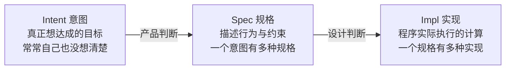

# 第 1 讲 欢迎来到未来

**一句话：** AI 让"实现"变便宜了，但"怎么让工程不失败"这个问题一点没变。（[讲义](https://jyywiki.cn/GSE/2026/lect1.md) · [slides](https://jyywiki.cn/GSE/2026/slides1.html)）

## 起点问题

- 作业交给 AI 也能拿满分，那满分证明了谁的能力？作品和能力之间的对应关系变了。
- 课程要讨论的是：当实现软件的成本剧变，什么能力还值得训练。
- 大学还能给你的三样东西：信息差、能承担后果、能驾驭。课程最关心"驾驭"，也就是把人、工具和反馈组织起来做成一件事。
- 课堂口号"禁止古法编程"：实现交给 Agent，人的注意力放在问题、设计和检验上。仍然要理解程序。

## 从语言模型到 Agent

- 使用者视角：语言模型是 `Pr[token | context]`，给定上下文预测下一个 token。
- 输出会进入后续上下文，所以一个静态分布能展开成很长的计算。思维链就是把中间步骤写在"工作纸"上。
- Agent 多了工具：读文件、跑命令、查网页，观察结果再决定下一步。承载这个反馈循环的外围系统叫 **harness**。
- 评价 Agent 要看三件事：它能观察什么、能操作什么、操作后能否知道自己做对了。

## 先用好，再理解原理

- 例子：让 AI 在 USB 上装好 Debian 并在 QEMU 里验证；邮件归档和起草回复；把视频转成讲义。
- 限制我们的，经常是没想到"这件事也能委托"。从一天里重复、烦琐、又能判断对错的任务开始。
- 但"先用好"仍然包含验收：系统能不能启动、数据是否保存正确，都要有证据。
- 第一次让 Agent 探路，成功后沉淀成可检查的脚本，探索就变成了可复用资产。
- **Everything is code**：视频可以由脚本和时间线描述，物体可以由 CAD 模型描述，Agent 的工作范围因此远大于"写程序"。

## 案例：二维码 Excel 为什么掉进泥潭

需求：只用 Excel 2019 兼容公式，把几千字符的字符串做 Base64 编码，切成多帧二维码循环播放，扫描后能拼回原文，并且要在接近真实的环境里验证。

| 尝试 | 结果 |
| --- | --- |
| GLM-5.3 第一次 | 第一轮思考 25 分钟，撞上输出长度限制，最终花了 6 小时 |
| DeepSeek V4 Pro | 交出硬编码版本，被指出后承认要重新设计 |
| 产物 | 约 2 MB，难以维护，加一点需求就要大改 |
| 少量提示调整后的 GLM-5.3 | 在 200K 上下文内做出正确且可维护的版本，公式可复用 |

教训：

- 硬编码说明演示成功和需求实现之间差得很远：用户要的是对所有输入都成立的计算过程。
- 真正改变局面的是**计算结构的设计**：输入变长时数据可以增加，但表达算法的模板不该被复制。
- 判断 AI slop 的关键不是文件多大、代码多丑，而是**修改有没有局部性**。改一处就要重来全部，就是《人月神话》里的焦油坑。

## Intent、Spec、Impl 之间的缺口

两个缺口各对应一类判断；没说清的地方，模型会自己做决定。

- **Intent**：你真正想达成的目标，往往连自己都没想清楚。
- **Spec**：把意图具体化后，能描述行为与约束的规格。
- **Impl**：程序实际执行的计算，每个分支都必须有确定动作。
- Intent → Spec 需要产品判断，Spec → Impl 需要设计判断。每一步都有多种选择，测试通过也只能说明满足了这些检查。
- 模型靠猜来填空。颜色、变量名猜错代价小；架构、数据表示、验收标准猜错代价大。
- "立即遵循指令"的风险：重要选择还没被看见，就已经固化进代码。好的协作要让重大假设及早暴露，也要留出推翻它的空间。

## 让大工程获得及时反馈

- 拆解、验证、迭代仍然有用，它们缩短了"做了决定"和"知道决定对不对"之间的距离。
- 二维码 Excel 的正确开发顺序：短字符串单帧 → 独立解码器真实读回 → 扩展到 Base64 和分片 → 验证多帧顺序与拼接 → 最后处理刷新、兼容和性能。每一步都留下可执行的检查。
- 生成越来越快，逐行阅读却很难同样加速。新的瓶颈是好的规格、独立检查器、测试、可观测性和清晰接口。
- 课堂抛出的问题：为什么要招你，而不是买一个 $200 的 Claude Max？展示项目时，要能说清楚你发现了什么问题、怎样把模糊愿望变成可检验目标、失败时凭什么换路。
