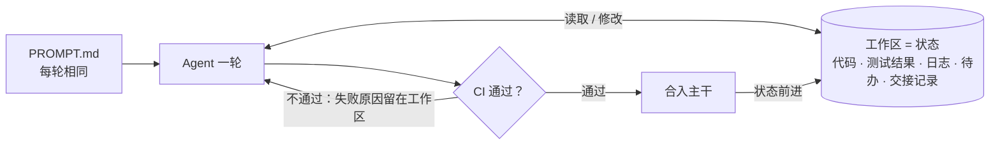

# 第 8 讲 Agent Native 开发

**一句话：** 从一开始就把 Agent 当作真正的开发者，为它设计工作环境；能识别进展的反馈，才让"不断尝试"有价值。（[讲义](https://jyywiki.cn/GSE/2026/lect8.md) · [slides](https://jyywiki.cn/GSE/2026/slides8.html)）

## 总得从一个能运行的原型开始

- 本质复杂性来自问题本身，不能消失；偶然复杂性来自工具和实现方式，值得不断消减。
- "Let it fail" 不是随便交差，而是让原型暴露错误：实现可能不符合规格，规格可能不符合需求，需求的假设也可能不成立。

## Ralph Loop

Geoffrey Huntley 提出的极简循环（[介绍](https://ghuntley.com/ralph/)）：

```bash
while true; do
    cat PROMPT.md | claude -p
done
```

- 提示词不变，**工作区在变**：上一轮留下实现、测试结果和失败记录，下一轮接着做。
- 循环本身没有魔法。必须另外定义验收条件、预算和停止条件；反复撞同一个失败，要怀疑任务表述、工具或架构。



每一轮都从同一个提示词开始，只有通过 CI 的改动才让状态前进；失败也会留下记录，供下一轮使用。停止条件要另外定义：验收达成、预算用尽，或同一失败反复出现。

## 工作区是状态，Agent 是状态迁移

- 工作区包括代码、需求、设计文档、测试、日志和待办。每轮 Agent 把它从一个状态迁移到下一个状态。
- 长程任务不能靠越来越长的聊天记录维持。新一轮 Agent 要能从留下的材料里恢复判断。
- 交接要具体："选课功能已完成"不如"普通选课已通过，两个请求抢最后一个名额的测试失败，日志在某处"。
- Git、Jujutsu 让状态可以分叉并行，但并行不自动保证任务独立，任务划分和集成检查要跟上。

## 每次迁移都检查：重新发现 CI/CD

- 出发点：开发者是不可信的，人类也一样。"我只改了一点点"往往是事故的开场白。
- 把"好"变成具体条件（能构建、测试通过、没破坏已有功能），集成时自动检查，这就是 CI。
- CD 两个含义：持续交付（随时可发布，由人决定上线）；持续部署（通过检查自动发布）。
- 底层机制很简单：事件发生时执行指定动作（Hook）。
- 有检查不等于检查有约束力：测试失败还能合并，红灯就只是摆设。要用分支保护、必需状态检查、合并队列把门关上。

## 把发布流程也写成 Spec

课程网站的流程约定示例：

- 合并请求有新提交就跑 Lint 和测试；合并前检查与最新主干的组合，失败禁止合并。
- `main` 更新后检查并构建，全部成功才部署，失败保留上一版。
- 多次发布重叠时，过时产物不能覆盖新版本；例外放行要有权限和记录。

验收时要观察失败路径：故意引入 Lint 错误，确认真的拦住了合并。检验的是"门是否关得住"。

## CI 阻止，Agent 修正

- Agent 生成快，积累维护负担也快。常见偏执：一句话的事写成 20 KB 文档、同一细节到处复制、在小问题上反复加固、代码能跑但难读。
- 能机械判断的部分交给检查：入口文档大小限制、禁止的依赖方向、复杂度规则、重复内容检测。
- 检查要说明为什么失败、怎么修，否则 Agent 会浪费时间猜规则。
- 闭环：**CI 阻止，Agent 修正，再由同一套标准验证。**
- 边界：负责实现的 Agent 不能为了过检查而单方面调低标准。删掉失败断言得到的绿色，和修好程序得到的绿色，含义完全不同。

## Agent Native 的四个问题

1. 人脑里的知识外部化了吗？重要决定进入版本管理，入口文档负责引导查阅。
2. Agent 能自己看到程序行为吗？能启动实例、操作页面、看日志，就不用等人转述"按钮好像没反应"。
3. 架构品味能变成可检查的规则吗？比如组件不得绕过业务层访问数据。
4. 清理工作在持续发生吗？小规模经常修复，防止坏模式扩散。

参考：[OpenAI Harness engineering](https://openai.com/index/harness-engineering/)

## 三个工业案例

| 案例 | 做法 | 可以学的 |
| --- | --- | --- |
| [Stripe Minions](https://stripe.dev/blog/minions-stripes-one-shot-end-to-end-coding-agents-part-2) | Blueprint 混合工作流：需要判断的步骤交给 Agent，Lint 等固定步骤由普通代码执行；限制 CI 重试轮数 | 固定工序写进流程；重试有成本 |
| [Anthropic C 编译器](https://www.anthropic.com/engineering/building-c-compiler) | 16 个 Agent 编 Linux 时撞上同一错误；改用 GCC 编大部分文件，切换编译器缩小失败范围 | 先改善任务表示和反馈，再加 Agent 数量 |
| [StrongDM](https://factory.strongdm.ai/) | 端到端场景放在代码库之外作独立验收；为外部服务建行为替身（Digital Twin Universe） | 防止 Agent 改测试迁就实现；替身与真实系统的差异也要验证 |

## 垃圾回收解决不了的问题

- 持续清理技术债像垃圾回收，但解决不了失效的设计假设。
- Friendster：主库加完整副本的架构，写入增长后加读副本也解不了瓶颈；工程师提出的按用户拆分方案没能推进。看出该怎么改，和组织真能改掉，是两件事。
- Webvan：配送中心业务量不到设计容量的 40%，需求密度没验证就建了庞大仓配系统。
- Quibi：有内容、有技术，但用户未必需要这样一个独立服务。
- Agent 让实现更便宜，项目可能逐步"slop 化"：越来越像成品，关键假设却被埋得更深。失败没有改变判断，下次循环只会更快重复。

## 实践机会会变成判断力差距

- 工程判断来自比较和亲手遇到问题。Token 预算代表试错机会，但只是让 Agent 不停输出，不会自动积累能力。
- 风险判断：实践机会的差距可能积累成判断力的差距，教育组织未必跟得上。
