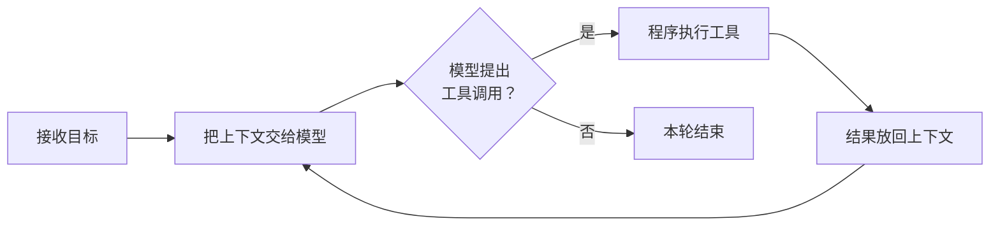

# 第 9 讲 DeepSeek Harness

**一句话：** 一个 150 行的 Agent 循环就能工作，真正的软件工程问题是它怎样容纳不断增加、甚至突然转向的需求。（[讲义](https://jyywiki.cn/GSE/2026/lect9.md) · [slides](https://jyywiki.cn/GSE/2026/slides9.html)）

## 150 行的 Agent，完全可以工作



- mini-agent 的核心就是上面这个循环。
- 演示任务：生成相对真实的南大仙林校区 3D 图。用 OpenStreetMap 的建筑和道路轮廓构建场景；空间布局有数据依据，楼高等细节是估计，所以"相对真实"有明确含义。
- 很快暴露问题：网络或模型服务一断，程序直接崩溃。它悄悄假设了每次请求都会顺利结束。

## 失败恢复是需求本身

- 如果要让用户托付真实工作，故障处理就是本质复杂性，主循环写得再短也不会让网络变可靠。
- "失败就重试"没那么简单：断网、限流可以有限重试；输入损坏、权限不足重试无用。
- 最难的是结果未知：**没收到成功消息，不等于操作没执行。** 文件已经移动但结果没记录就崩溃，恢复时直接重放可能造成二次损害。
- **幂等性**：同一逻辑操作重复提交不应产生额外效果。用稳定的操作标识识别重试，记录已执行的结果。参考 [AWS 的重试设计经验](https://aws.amazon.com/builders-library/making-retries-safe-with-idempotent-APIs/)。

## 一个小循环，被真实世界包围

- 后续需求：项目管理、工具与 Skills、沙箱与权限、上下文压缩、记忆与索引、文件编辑、远程访问、App 同步、备份恢复。
- 办公 Agent 例子："整理成周报"意味着找资料、核对、生成可编辑文件，还要说明哪里缺资料。
- 暂停、取消、恢复各是一组状态迁移：取消后已完成的修改不会自动消失，恢复时要检查外部文件是否变了。
- 权限不能只写进提示词：读目录、改文件、外发内容是不同动作；网页或文档里出现的命令只是待处理资料，不能变成新的用户授权。

## 需求还会突然转向

- Grok Bot 走红后，用户开始期待持续工作的助手、定时任务和多助手协作。底层模型没变，用户理解产品的方式变了。
- dsh 社区很快出现 [dsh-bot](https://github.com/Nothing1024/dsh-bot)，支持多 Bot 配置、定时例程和互相通信。
- 关心的是变化成本：能否复用已有的会话、执行和工具能力，而不是从入口改到最深处的循环。

## 架构：用一部分自由，换一类便利

| 架构 | 你接受的限制 | 得到的便利 | 什么时候泄漏 |
| --- | --- | --- | --- |
| 操作系统进程 | 独立地址空间，通过系统调用访问资源 | 隔离、调度、互不破坏 | 内存不够频繁换页、资源竞争 |
| 托管语言（Java） | 对象、类型、引用规则 | 垃圾回收，不用管释放 | 低延迟场景里 GC 暂停进入体验 |
| LAMP | 请求 → 逻辑 → 数据库 → 页面 | 成熟的 Web 服务、事务、备份 | 长连接让进程池被占满；回滚撤不了外部扣款 |
| Event Sourcing | 记录事实，从事实计算状态 | 同时知道"现在是多少"和"为什么" | 回放不能重复扣钱；规则变化要处理 |
| MapReduce | 计算写成 map → 分组 → reduce | 并行、调度、失败重试 | map 里有副作用会重复执行；热点 key |

- 架构变成阻力，往往不是它变坏了，而是它替你固定下来的选择不再合适，这就是**抽象泄漏**。
- MapReduce → Spark（多阶段、缓存）→ Flink（流处理、水位线、检查点）：新需求会带着整个技术栈一起重组。
- 把视角扩大到组织：AI 让小工具变得值得做，瓶颈可能转向验收、信任和物理执行。

## dsh 的设计：Everything is a plugin

- 模型适配器、工具、会话日志，甚至默认 Agent Loop 都是插件。底层 Cordis 负责服务解析、依赖激活、作用域和卸载。
- 插件之间要协同：不协同是孤岛，随便协同是混乱。需要少量稳定的共同概念，也就是 harness 的"世界模型"：**Session、Agent、slots**。
- **Session = list[Event]**：会话是一串有序事件。模型消息历史、界面、业务状态都是同一份事实的不同**投影**。区分"记录一件事"和"计算它意味着什么"。
- **Agent 的三种输入**：
    - `followup`：普通后续输入，排入新一轮并唤醒执行。
    - `inject`：补充上下文，不唤醒空闲 Agent。
    - `steer`：中途改变方向，尽快交给下一步。
- 动态上下文：插件注册一个函数，组装上下文时读取最新状态（如当前选中的对象），避免模型看到过期信息。
- Hook 的时间方向：`session/event` 面向已发生的事实（纠正要追加新记录）；`agent/pre-step` 面向尚未执行的决策。混在一起，"插件改变行为"就会变成"插件悄悄改写历史"。

```ts
ctx.on('agent/pre-step', async (payload, next) => {
  const decision = await next()
  return decision
})
```

## 插件挂上总线，冲突也一起进来

- 框架管得了插件何时加载卸载，管不了业务语义：先改写再检查和先检查再改写，检查的不是同一份东西。
- 思想实验：装 10 个各压缩一半的上下文压缩插件，剩下 (1/2)^10 = 1/1024。局部合理不保证整体合理。
- 卸载插件会撤销它的注册，但不会撤回它发出去的邮件或改过的文件。

## Vibe 与生态

- jyy 对 vibe 的定义：用自然语言表达想法，让 Agent 快速实现，再观察和修改。
- Creator Mode：用户许愿，Agent 写插件并装配，用户在真实环境里体验。反馈发生在使用现场。
- 他对社区的尖锐评价："dsh 的开源社区走远了"。开放架构应该让每个人有能力满足自己的小需求，而不只是收集现成插件。

## 两个探索方向

- **大型 App 的 AI 增强 = 锁定对象 + 序列化对象 + UI**。Excalidraw 插件：选中图形 → 锁定选区 → 把 JSON 交给会话 → 模型通过 `replace_selection` 提交替换 → 检查不许改选区外对象 → 成功才应用，失败解锁并保留原样。
- **GenUI**：模型生成可交互卡片，卡片和 Session 双向通信。例子：在棋盘上点击落子，模型读局面选应手。棋盘规则和合法走子由程序维护，模型负责选择和解释。
